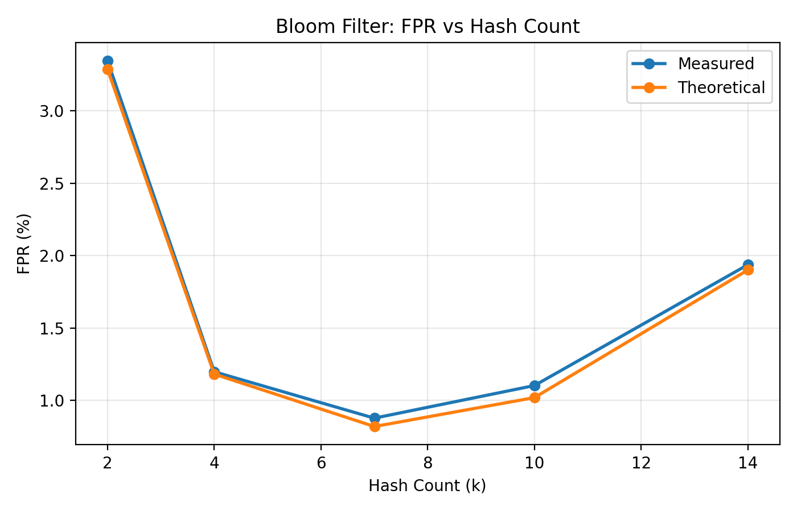
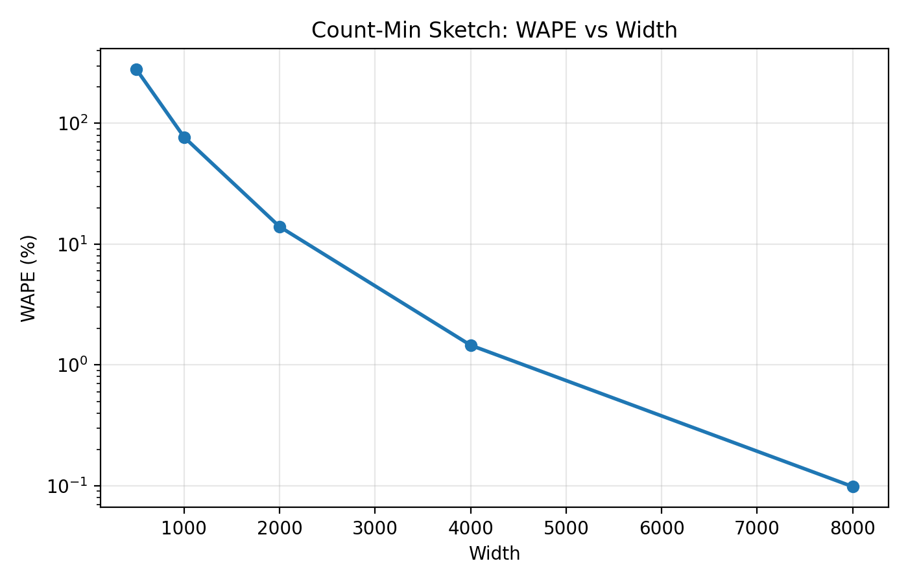
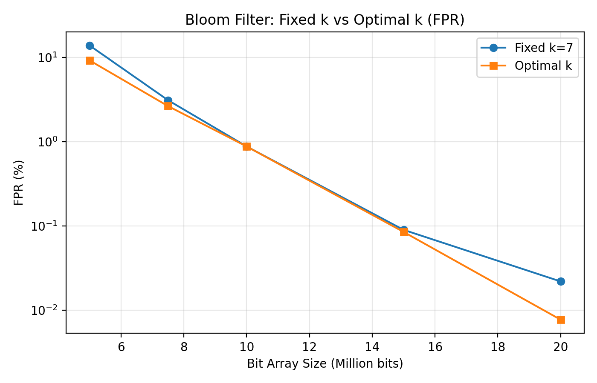

# Streaming Algorithm Benchmark
## [과제4] 스트리밍 알고리즘 비교 실험

MovieLens 1M 데이터를 이용해 **Bloom Filter**와 **Count-Min Sketch**를 Python으로 직접 구현하고, 정확도·메모리·처리시간의 트레이드오프를 비교한 실험 프로젝트입니다.

## 1. 실험 개요

- **데이터셋:** [MovieLens 1M](https://files.grouplens.org/datasets/movielens/ml-1m.zip)
- **평점 레코드:** 1,000,209건 / **사용자:** 6,040명 / **영화:** 3,706개
- **처리 방식:** `ratings.dat` 파일을 제너레이터(`yield`)로 한 줄씩 읽어서 스트림 처리
- **실험 환경:** Google Colab, Python 3.13.18, Linux, CPU 논리 코어 2개
- **주요 라이브러리:** Python 표준 라이브러리(`hashlib`, `array`, `time`, `sys` 등), pandas 2.2.3, matplotlib 3.10.0

데이터는 노트북 실행 시 다운로드하므로 원본 MovieLens 파일은 저장소에 포함하지 않았습니다.

## 2. 알고리즘 및 구현

| 알고리즘 | 목적 | 스트림 입력 | Ground Truth |
|---|---|---|---|
| Bloom Filter | 특정 사용자가 특정 영화를 평가했는지 포함 여부 판정 | `user_id:movie_id` | `set` |
| Count-Min Sketch | 영화별 평점 횟수 추정 | `movie_id` | `dictionary` |

**Bloom Filter**는 비트 배열과 다중 해시 인덱스, 삽입·포함 여부 검사를 직접 구현했습니다. **Count-Min Sketch**는 2차원 카운터 배열과 해시 인덱스, 빈도 갱신·최솟값 조회를 직접 구현했습니다. 두 알고리즘 모두 Python 표준 라이브러리의 BLAKE2b 해시를 사용하며, 해시값으로부터 여러 인덱스를 생성하는 로직을 구현했습니다.

정확도 평가를 위한 Ground Truth는 별도 순회로 계산합니다. 근사 알고리즘 자체는 전체 평점 레코드를 저장하지 않습니다.

## 3. 기본 설정 및 결과

| 측정 항목 | Bloom Filter | Count-Min Sketch |
|---|---:|---:|
| 기본 파라미터 | `m=10,000,000`, `k=7` | `width=2,000`, `depth=5` |
| 주요 정확도 지표 | FPR **0.8780%** (음성 테스트 100,000건) | WAPE **13.9603%** (영화 3,706종) |
| 추가 정확도 지표 | FN **0건** | MAE **37.6773**, 정확히 추정한 영화 **58.50%** |
| 자료구조 메모리 | **1.1921 MiB** | **39.5703 KiB** |
| 정확한 자료구조 대비 메모리 절감률 | **98.50%** (`set` 대비) | **88.59%** (`dict` 대비) |
| 평균 전체 처리시간 (3회) | **9.0445초** | **7.1005초** |
| 초당 처리량 | **110,588건/초** | **140,865건/초** |

> **해석 시 주의:** 두 알고리즘은 수행 작업과 오차 지표가 서로 달라 FPR과 WAPE, 처리시간을 직접 대조해 우열을 판단하기 어렵습니다. 처리시간은 ZIP에서 데이터를 읽고 삽입하는 구간을 포함하며, 메모리는 `sys.getsizeof()`를 이용한 주요 자료구조 크기(전체 프로세스 사용량 아님)입니다. Colab 환경에 따라 시간 측정값은 달라질 수 있습니다.

## 4. 파라미터 비교

각 실험은 다른 파라미터를 고정하고 하나씩 변경했습니다. 시간은 각 설정을 **3회 실행한 평균**입니다.

| 구분 | 변경 값 | 고정 값 | 관찰된 경향 |
|---|---|---|---|
| BF 비트 배열 크기 `m` | 5M, 7.5M, 10M, 15M, 20M | `k=7` | FPR **13.840% → 0.022%**, 메모리 증가 |
| BF 해시 개수 `k` | 2, 4, 7, 10, 14 | `m=10M` | **k=7**에서 최저 FPR **0.878%**; 더 늘리면 오히려 악화 |
| CMS `width` | 500, 1,000, 2,000, 4,000, 8,000 | `depth=5` | WAPE **280.8308% → 0.0983%**, 메모리 증가 |
| CMS `depth` | 2, 3, 5, 7, 9 | `width=2,000` | WAPE **71.5102% → 4.0403%**, 처리시간 증가 |

**심화 실험:** Bloom Filter의 이론적 최적 해시 개수 `k ≈ (m/n)·ln(2)`를 적용했습니다. `m=20M`일 때, 고정 `k=7`의 FPR 0.022%에 비해 최적 `k=14`의 FPR은 0.009%로 낮아졌지만 처리시간은 **9.1717초 → 12.3812초**로 증가했습니다(파라미터 실험의 3회 평균).

## 5. 주요 그래프

**Bloom Filter — 해시 개수에 따른 FPR**



**Count-Min Sketch — 너비에 따른 WAPE**



**Bloom Filter — 고정 k와 최적 k의 FPR 비교**



나머지 7개 그래프는 [`figures/`](figures/)에서 확인할 수 있습니다.

## 6. 실행 방법

1. `streaming_algorithms.ipynb`를 Google Colab에서 엽니다.
2. **런타임 → 모두 실행**을 선택합니다. MovieLens 1M ZIP 파일은 자동 다운로드됩니다.
3. Ground Truth, 기본 실험, 파라미터 변경 실험, 그래프 생성 순서로 진행됩니다.
4. 실험 결과 표는 `results/`의 CSV 파일에 저장되어 있으며, 노트북 실행 시 새로 생성할 수 있습니다.

원본 데이터 경로와 다운로드 URL은 노트북 내부에 설정되어 있습니다. 실험은 반복 실행 횟수와 파라미터 설정에 따라 여러 차례 전체 스트림을 순회합니다.

## 7. 파일 구성

```text
streaming-algorithm-benchmark/
├── streaming_algorithms.ipynb
├── README.md
├── results/
│   ├── bf_m_results.csv
│   ├── bf_k_results.csv
│   ├── cms_width_results.csv
│   ├── cms_depth_results.csv
│   └── bf_optimal_k_results.csv
└── figures/
    ├── bf_m_fpr.png
    ├── bf_m_memory.png
    ├── bf_k_fpr.png
    ├── bf_k_time.png
    ├── cms_width_wape.png
    ├── cms_width_memory.png
    ├── cms_depth_wape.png
    ├── cms_depth_time.png
    ├── bf_optimal_k_fpr.png
    └── bf_optimal_k_time.png
```

## 8. 결론 및 한계

- Bloom Filter는 약간의 False Positive를 허용한다면 존재 여부를 적은 메모리로 빠르게 확인하는 데 적합합니다.
- Count-Min Sketch는 고유 항목 종류가 많아 정확한 빈도 딕셔너리가 커지는 스트림에서 유용할 수 있습니다. 이번 데이터에는 영화가 3,706개뿐이므로 정확한 `dict`도 비교적 작다는 점을 고려해야 합니다.
- 정확도 개선에는 대체로 메모리 또는 처리시간의 추가 비용이 필요하고, Bloom Filter의 해시 개수처럼 **파라미터를 무조건 늘린다고 결과가 개선되는 것은 아닙니다.**
- Bloom Filter와 Count-Min Sketch는 목적이 서로 다르므로 실제 서비스에서는 이벤트 중복 여부 확인과 빈도 집계라는 **분석 목적에 따라 선택**하는 것이 적절합니다.

## 데이터 출처

- GroupLens Research, [MovieLens 1M Dataset](https://grouplens.org/datasets/movielens/1m/)
